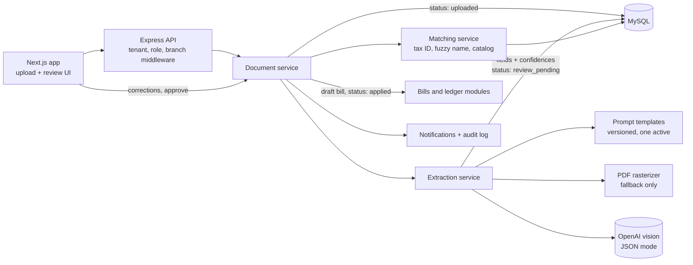

# AI Document Extraction in a Multi-Tenant Accounting SaaS

A multi-tenant accounting platform for small and mid-sized businesses covering the general ledger, invoices, bills, payments, bank reconciliation, POS, tax reporting, and multi-branch operations. Its AI feature turns a photo or PDF of a supplier invoice into a draft bill: an OpenAI vision model extracts structured fields with confidence scores, the system matches the supplier and products against the company's own records, and a human reviews and corrects the result before anything is posted.

## The problem

- Entering supplier bills by hand is slow and error-prone, and it is one of the most repetitive tasks in small-business bookkeeping.
- Fully automatic posting is not acceptable in accounting. Every extracted value must be reviewable, correctable, and auditable before it touches the ledger.
- The feature had to respect the platform's tenant isolation, role permissions, and optional branch scoping like every other module.

## My role

Design and implementation.

## Approach

1. **Upload and persist first.** A document is stored with status `uploaded` inside a transaction, then extraction runs outside that transaction.
2. **Vision extraction to JSON.** The document is sent to an OpenAI vision model with the active prompt template and company context such as base currency and country. The model returns structured JSON in JSON mode.
3. **Per-field storage with confidences.** Each extracted field is saved as its own row with a confidence value, and the document gets an overall confidence, so the review screen can highlight weak fields.
4. **Matching against company data.** Suppliers are matched by tax registration number first, then by fuzzy name match. Line descriptions are matched to the product catalog, and expense accounts resolve from explicit input, then supplier default, then a fallback account.
5. **Human review, then apply.** A reviewer corrects fields and selects the supplier match. Applying creates a draft bill in one transaction, records corrections, and marks the document as applied.

## Architecture

## Key engineering decisions

- **Long AI calls never hold a database transaction.** Creation commits first; extraction and matching run afterwards. A failure leaves the document persisted with status `failed` instead of rolling back the upload.
- **Explicit document lifecycle.** States move from uploaded to review pending to applied, or to failed or discarded. Applied documents cannot be reprocessed or discarded, which keeps the audit trail consistent with the ledger.
- **Prompts as data.** Extraction prompts are stored as versioned templates with variable placeholders and a single active version, so prompts can be tuned without a deploy.
- **Deterministic matching after probabilistic extraction.** The model only reads the document. Supplier and product matching use exact tax ID lookup and Levenshtein-based fuzzy scoring against the tenant's own data, with candidates logged for review.
- **Optional PDF rasterization.** PDFs are passed to the model directly when supported; a rasterizer converts the first pages to images only as a fallback, avoiding a mandatory heavy dependency.
- **Same guards as the rest of the platform.** Tenant context flows through request-scoped storage, branch rules apply through a single helper, and every create, reprocess, apply, and discard writes an audit entry.

## Platform scope

The extraction feature is one module in a larger platform with around 28 backend feature modules, including chart of accounts, journal entries, invoices, bills, payments, bank reconciliation, VAT reporting, POS, multi-currency, report snapshots, notifications, and opt-in multi-branch support with per-user branch access.

## Tech stack

- **Backend:** Node.js, Express, Sequelize, MySQL 8, node-cron jobs with distributed locks, Puppeteer for PDFs
- **Frontend:** Next.js 14, Tailwind CSS, shadcn/ui
- **AI:** OpenAI vision models with JSON-mode structured output
- **Infrastructure:** Docker Compose, MailHog for local email

## Outcome

- Released as version 1.0 and marked pilot-ready, with a status page, runbook, and onboarding guide.
- Extraction adoption and average confidence are tracked in the platform's own reporting, so the feature's usage is measurable inside the product.

Source code is private.
