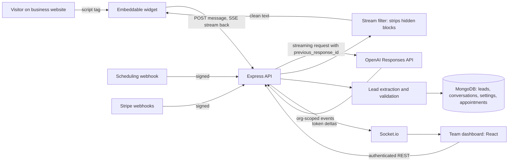

# Embeddable AI Sales Assistant

A multi-tenant SaaS that gives businesses an AI sales assistant they can embed on their own website with one script tag. The assistant streams replies to visitors in real time, qualifies them as leads while the conversation is still going, spots booking intent and hands over a scheduling link. Team members watch live conversations and a lead pipeline in a separate dashboard.

## The problem

Small sales teams lose inbound visitors outside working hours and spend time on conversations that never convert. They wanted an assistant that could:

- answer website visitors immediately, in the business's own tone
- capture contact details and judge how serious and urgent each visitor is
- move qualified visitors to a booked call without a human stepping in
- show the team what is happening, live, without exposing one customer's data to another

## My role

Design and implementation: backend API, AI integration, the embeddable widget, real-time dashboard updates, multi-tenancy, and subscription billing.

## Approach

1. **Embeddable widget.** A small script served by the API loads on any website, reads the tenant's branding and greeting from a public config endpoint, and opens a chat panel.
2. **Streaming replies.** Each visitor message goes to the OpenAI Responses API with streaming on. Tokens are sent to the browser as server-sent events, so the reply appears while it is still being generated.
3. **Conversation memory without resending history.** Each turn stores the model's response ID and passes it back as `previous_response_id` on the next turn, so context lives on the provider side and every request stays small.
4. **Structured data inside the reply.** The system prompt asks the model to append hidden, delimited blocks for lead data (contact details, intent score, urgency) and booking intent. A small streaming parser removes these blocks before any text reaches the visitor. The completed reply is then parsed into structured lead updates.
5. **Lead qualification.** Extracted values are validated and clamped, then compared against a qualification threshold the tenant sets, which moves the lead to "qualifying" or "qualified".
6. **Booking handoff.** When booking intent is detected, the stream sends a booking event carrying the tenant's scheduling link. A signed scheduling webhook later matches the booked appointment to the lead.
7. **Live dashboard.** A Socket.io channel, authenticated with the dashboard user's token and scoped to their organization room, pushes visitor messages, assistant replies, lead updates and session ends as they happen.

## Architecture

## Key engineering decisions

- **Filtering hidden markers in the stream.** Markers can arrive split across token boundaries. The parser holds back a trailing partial delimiter until the next delta shows whether it opens a hidden block, so structured data never flashes on screen.
- **Provider-side conversation state.** Chaining on `previous_response_id` avoids resending the full transcript on every turn and keeps the conversation going across page reloads. A blocked message keeps the previous ID, so a refusal does not break the chain.
- **Defensive input handling.** Visitor messages are checked against common prompt-injection patterns before reaching the model, and a fixed safe reply is returned when one matches. Model calls run under a 30-second abort timeout.
- **Tenant isolation everywhere.** Every authenticated request carries a tenant context taken from the auth token. Queries, socket rooms and webhook lookups are all scoped by organization, including matching scheduled appointments to leads, so data cannot leak between tenants.
- **Billing as middleware.** A subscription gate allows active and trialing tenants through, starts a trial for existing organizations without subscription data, and blocks expired or past-due accounts. Stripe webhook signatures are checked against the raw request body.
- **Per-tenant configuration.** Tenants set their own system prompt additions, greeting, placeholder text, booking behavior and qualification threshold, and the system prompt is built from these settings on each request.

## Tech stack

- **Backend:** Node.js, Express, Mongoose (MongoDB), Socket.io, express-rate-limit, schema validation
- **AI:** OpenAI Responses API (streaming), prompt-built structured output
- **Frontend:** React, Vite, Tailwind CSS, embeddable vanilla widget
- **Auth and billing:** Clerk (organizations), Stripe subscriptions and webhooks
- **Integrations:** scheduling provider webhooks with signature verification

## Outcome

- A working end-to-end flow: embed, stream a conversation, extract and score the lead, hand off a booking, and update the dashboard live.
- Separate rate limits for the public widget, typing indicator and authenticated endpoints.
- Lead pipeline views with status, urgency, intent score, search, sorting and aggregate statistics.

Source code is private.
