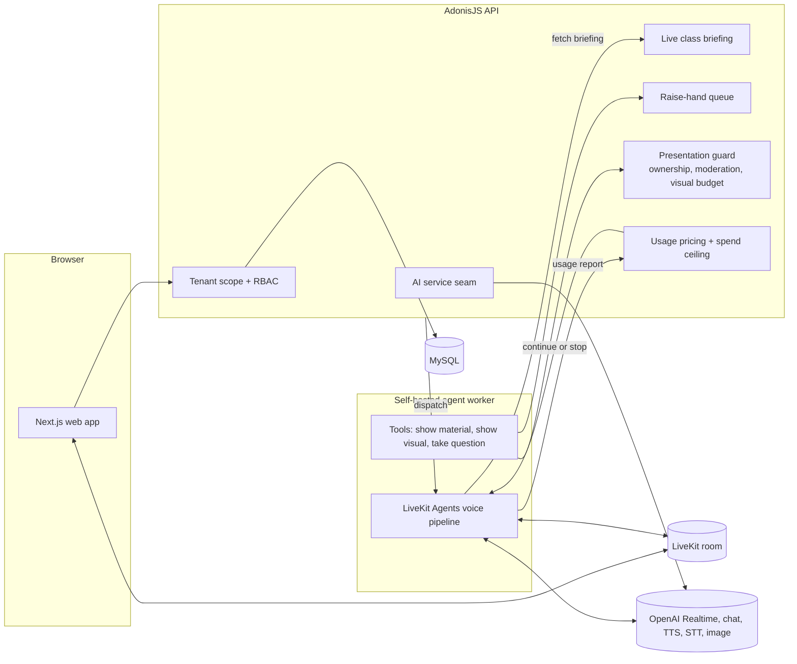

# AI Voice Teacher for a Multi-Tenant LMS

A multi-tenant learning management platform where each institution is an isolated tenant, extended with a suite of AI features: a realtime voice AI teacher that delivers live classes, a text and voice AI tutor, an AI speech coach, and an AI course builder. The voice teacher runs as a separate self-hosted worker on LiveKit Agents with the OpenAI Realtime API, while every tenant, entitlement, content, and spend decision stays in the main API.

## The problem

- Institutions wanted AI-led live classes, not just a chatbot: an agent that joins a real video room, lectures by voice, shows course material on screen, and takes questions from students.
- A long-lived realtime agent is expensive and hard to control. An unattended or buggy worker can run up audio costs, leak content across tenants, or listen to the wrong participant.
- The AI features had to sit on a strict multi-tenant foundation with role-based access, so no AI path could bypass the same guards the rest of the platform uses.

## My role

Design and implementation.

## Approach

1. **Tenancy and RBAC foundation first.** Single database, shared schema, an institution key on every tenant-owned table, request-scoped query scoping and write stamping, a permission catalog with system roles plus per-tenant custom roles.
2. **Agent as an untrusted worker.** The voice teacher is registered under an agent name and only enters a room when the API explicitly dispatches it. It asks the API for a briefing and obeys; it never queries content itself.
3. **Tool calls for presenting and turn-taking.** The model calls tools while it teaches to show course material, show a generated visual, and take the next question. The API re-validates every call.
4. **Server-side cost accounting.** The realtime model reports token usage as it runs; the API prices it and tells the worker when to stop.
5. **Shared AI service seam.** All OpenAI access for the tutor, speech coach, text-to-speech, transcription, and course generation goes through one mockable service, so tests never hit the network and the rest of the app stays provider-agnostic.

## Architecture

## Key engineering decisions

- **The API owns every decision that matters.** What the agent may know, what it may show, who it may hear, and when it must stop are all decided server-side. A compromised or buggy worker can only ask, which keeps it low-risk.
- **One controlled path to the agent's ear.** The agent cannot choose which student to hear. Its take-question tool asks the API to pop the raise-hand queue, and the API names exactly one participant. The model decides only when to take a question.
- **Spend ceiling enforced by the API, not the worker.** Usage reports are priced against configurable per-token rates and stored centrally. The worker is told to stop, so a broken worker cannot ignore its own cap.
- **Cost-aware session design.** The worker waits for a human before teaching, because lecturing to an empty room bills audio nobody hears. It also trims lecture history in the model context while keeping the system prompt intact, so long classes do not pay for their own history repeatedly.
- **Prompting for actions, not narration.** Each lecture segment instruction explicitly requires the tool call and forbids announcing a slide without showing it, after observing the model claim actions it had not taken. Tool refusals are returned as short, calm notes so the class never hears an error.
- **Safe retries.** Requests that fail on a stale keep-alive connection before reaching the server are retried, since nothing was processed or billed. Timeouts are not retried because their outcome is ambiguous.

## Other AI features

- **AI tutor:** chat and voice tutoring anchored to course content the student is already entitled to see, using the same access guards as content delivery. Input and output moderation, a refusal path for flagged messages, crisis checks, and per-user rate limits for chat, voice synthesis, and live calls.
- **AI speech coach:** realtime voice practice sessions over WebRTC, with the API key kept server-side and a hard, configurable session cap.
- **AI course builder:** generates course structure from instructor input, with heavier models reserved for generation and cheaper models for volume tasks.
- **Paid AI sessions:** institutions can charge for tutor or speech sessions through their connected payment account using a single-use prepaid pass.

## Tech stack

- **Backend:** TypeScript, AdonisJS 6, Lucid ORM, MySQL validation, Japa tests
- **Frontend:** Next.js, React, Tailwind CSS, LiveKit client
- **AI and realtime:** LiveKit Agents (Node), OpenAI Realtime, chat completions, text-to-speech, speech-to-text, image generation
- **Payments:** Stripe, including connected accounts
- **Tooling:** pnpm workspaces, Turborepo, shared types package, PM2

## Outcome

- Multi-tenant foundation, academic model, content delivery, grading, billing, and the AI features above are implemented in a monorepo with an automated test suite covering authentication, tenant isolation, and RBAC denials, among other areas.
- The voice teacher worker reports measured usage from real sessions, so class cost comes from actual token counts rather than estimates.

Source code is private.
