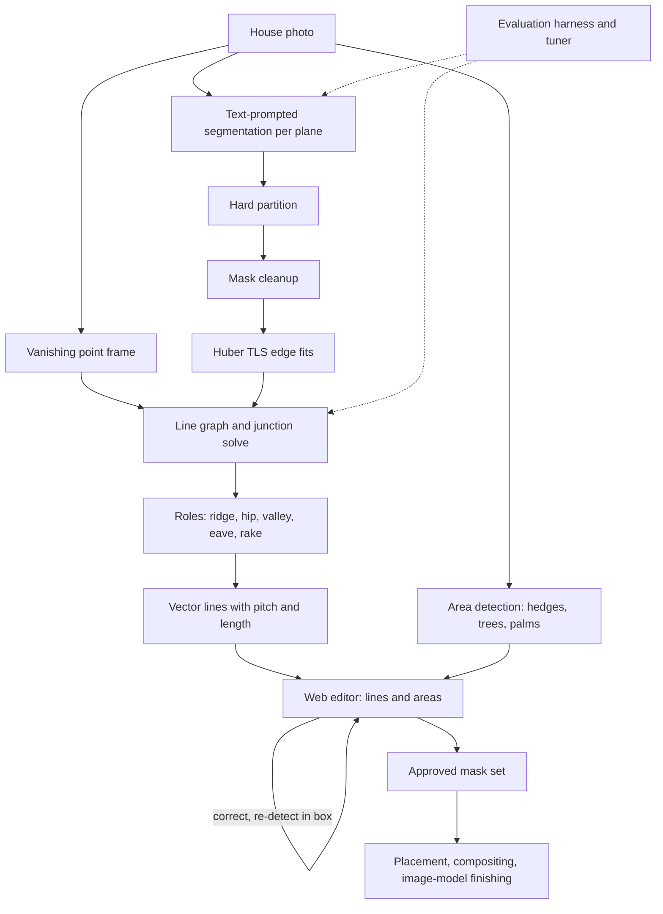

# Roof Geometry and Lighting Mock-ups from a Single Photo

Two linked systems for exterior lighting design. The first recovers a house's roof structure (ridges, hips, valleys, rakes and eaves) as clean vector lines from a single street-level photo. The second is a mock-up tool where a designer uploads a photo, detects or paints the regions to light (rooflines, hedges, trees, palms), corrects them, and locks an approved mask set that later placement and rendering steps build on.

## The problem

Lighting designers quote and pitch from photos of the customer's house. Tracing rooflines by hand is slow, and generic segmentation masks have wobbly, pixel-level edges that are useless for placing bulbs at an exact spacing. The work needed:

- straight, labeled roof lines with real geometry (slope, pitch, length), not raw mask outlines
- an editor where every automatic result can be corrected quickly
- a pipeline that is measured, so each change can be shown to help rather than just look better on one photo

## My role

Design and implementation: the computer vision pipeline, the evaluation harness, the FastAPI backends, and the web editors.

## Approach

### Roof line detection

1. **Plane partition.** A text-prompted segmentation model returns one instance per roof plane, and the instances overlap. They are turned into a hard label map in which contested pixels go to the smallest instance.
2. **Cleanup.** Morphological closing and opening, hole filling, speck removal, and notch filling from convexity defects. Convex hulls are never used, because they would erase real geometry.
3. **Robust edge fitting.** Polygon simplification only seeds corners. Each edge is then fitted with Huber total least squares over its trusted boundary pixels, and near-parallel neighbors are merged.
4. **Vanishing points.** Line segments from the whole photo (walls, windows, doors) are used to estimate a consistent Manhattan frame, which keeps line directions physically plausible.
5. **Line graph.** Edges are clustered into lines and corners into junctions, with T-junction detection, and solved by minimizing a combined fit and direction energy.
6. **Roles from topology.** A shared edge that is horizontal in plan is a ridge. A shared sloped edge is a hip, or a valley if its low end sits in a re-entrant corner. Free edges become eaves or rakes.
7. **Output.** JSON segments with pixel endpoints, role, slope, angle, roofing pitch (rise over 12) and length, plus a closed polygon for each plane.

### Lighting mock-up workflow

1. Upload a photo with a plain-language instruction, then choose automatic or manual masking.
2. Automatic mode detects rooflines (as selectable spans tagged front, left or right) and area regions: hedges, shrubs, topiaries, palm trunks, palm fronds and tree canopies.
3. The designer corrects regions with a brush and eraser, by dragging polyline vertices, or by drawing a box to re-run segmentation on one area. Undo and redo cover every action.
4. Approve locks the mask set. The design places bulbs from this geometry before an image model does photoreal finishing, so spacing stays exact and revisions are reproducible.

## Architecture

## Key engineering decisions

- **Masks support lines but never become lines.** Interior lines come from adjacency between planes, and exterior lines from robust fits over trusted boundary arcs. Raw mask boundaries and raw line-detector segments are never output.
- **Evaluation first.** The harness was built before the rebuild. It covers a synthetic scene generator with exact ground truth, annotated real photos, a held-out split, and watermark detection. Metrics are two-way chamfer distance as a fraction of the image diagonal, and matching F1 at several endpoint tolerances with angular error. A tuning loop searches thresholds on the training split and reports results on the held-out split.
- **Fast interactive geometry.** Segmentation runs once per photo and prompt and is cached. The geometry stages are cheap enough to re-run on every slider change, and any intermediate stage can be returned and inspected as an image layer.
- **Measured rollbacks.** An obstacle-handling feature was removed when it made detection less accurate, and the harness confirmed the detector exactly reproduced the earlier baseline.
- **Provider abstraction with an offline mock.** Detection and image providers sit behind one interface. A deterministic mock provider runs the whole UI with no API keys and no spend, which made development and smoke testing cheap.
- **Two region types.** Line regions take bulbs along a path at a set spacing, and area regions take bulbs distributed inside a mask. Each type has its own editing tools.

## Tech stack

- **Computer vision:** Python, OpenCV, NumPy, text-prompted segmentation models (SAM family, grounded detection), line segment detection
- **Backend:** FastAPI, Pydantic, SQLite (accounts and projects with scrypt-hashed passwords and signed HttpOnly cookies), disk caching
- **Frontend:** Next.js and React with TypeScript, Tailwind CSS, canvas-based editors
- **Image generation:** Gemini image model (planned rendering stage)
- **Tooling:** Docker Compose, API smoke tests, browser smoke tests with Playwright

## Outcome

- The roof pipeline outputs labeled vector roof lines with pitch and length, and has a reproducible evaluation and tuning workflow comparing the rebuilt pipeline against the frozen legacy baseline on held-out data.
- The mock-up tool's first milestone is complete: both masking modes, the correction loop and locked approved mask sets, covered by API and browser smoke tests.
- Bulb placement, compositing and image-model finishing are designed and scheduled for later milestones.

Source code is private.
